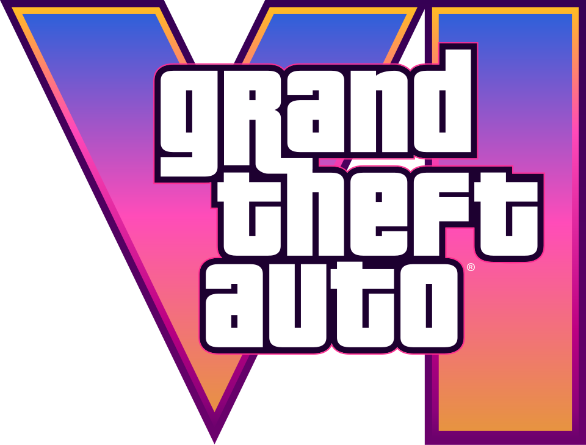

<div align="center">



# GTA VI — Launch Day Market Impact Dashboard

**Interactive financial dashboard analysing the US stock market & economic impact of Grand Theft Auto VI's launch on 19 November 2026**

[**→ View Live Dashboard**](https://aryaman28.github.io/gta6-market-dashboard/)


</div>

---

> **TL;DR:** GTA VI launched to a record **$3.79 billion in day-one revenue** and 32.5 million pre-release units — yet TTWO stock *fell* −3.68% that session in a classic "sell the news" move, amplified by a broader market correction (S&P −5.9% that week, VIX at 35.89). TTWO then recovered **+12.1% two days later** once first-week figures confirmed the game's historic scale.

---

## Dashboard Overview

A fully self-contained, single-file interactive dashboard built in vanilla HTML/CSS/JS. No frameworks, no build tools — just open `index.html`.

**5 tabs of analysis:**

| Tab | What's Inside |
|-----|---------------|
| **Overview** | 6 KPI tiles + TTWO 2-week price chart + launch-window bar chart + 5-day indexed comparison |
| **Stock Analysis** | Full 9-ticker price table (Nov 17–21) + analyst targets vs actuals + "buy the rumour" pattern + S&P/NASDAQ macro chart |
| **Revenue & Impact** | 6 economic KPI tiles + Day-1 cross-industry revenue comparison + analyst Year-1 projections + 7-day cumulative revenue ramp |
| **vs. Past Launches** | Publisher launch-day stock history + GTA VI vs GTA V era comparison + 3-day sector total returns |
| **Sources** | 17 cited sources across 4 categories — Financial, Gaming, Macro, News — all with URLs |

---

## Key Findings

### 1 · "Sell the News" — TTWO on Launch Day

| Date | TTWO Close | Day Delta | Story |
|------|------------|-----------|-------|
| Nov 14 (est.) | ~$235 | — | Pre-launch plateau |
| Nov 17 | $203.93 | −13% from est. | Anticipation unwind begins |
| Nov 18 | $216.61 | +6.2% | Pre-launch bounce |
| **Nov 19 (Launch)** | **$208.65** | **−3.68%** | **"Sell the news"** |
| Nov 20 | $210.00 | +0.7% | Stabilisation |
| Nov 21 | $235.47 | **+12.1%** | First-week data confirmed |

TTWO's 52-week high was **$265.94** — the stock spent 2026 pricing in GTA VI's success, then dipped on the day itself. The recovery came when the numbers landed.

### 2 · Record Revenue Scale

| Metric | GTA VI (2026) | GTA V (2013, adj.) | Multiple |
|--------|--------------|-------------------|----------|
| Day-1 revenue | **$3.79B** | ~$0.95B | **4x** |
| Launch price | **$80** | $60 | +33% |
| Pre-release units | **32.5M** | — | — |
| Year-1 consensus | **$3.77B** | — | — |

### 3 · Who Actually Won on Launch Day

| Ticker | Nov 17→20 Return | Reason |
|--------|-----------------|--------|
| **RBLX** | **+6.2%** | Gaming sector halo |
| **GME** | **+5.1%** | Accessories + hardware trade-ins |
| **NTDOY** | +5.6% then reversed | Initial lift, faded |
| **SONY** | **+2.3%** | PS5 as dominant platform ("overlooked winner") |
| TTWO | +3.0% (net, incl. recovery) | Sell news → recover |
| NVDA | −19.3% | **Macro/SEC probe — not GTA6** |
| AMD | −15.7% | **Macro correction — not GTA6** |
| S&P 500 | −5.9% | Broad market in correction |

> Note: The launch week coincided with a significant market-wide selloff (VIX 35.89, $5.5T erased from ATH). NVDA and AMD declines were macro-driven and should not be attributed to GTA VI.

---

## Design

Themed to GTA VI's Miami Vice aesthetic:

- **Background:** Deep Miami night (`#07050f`) with purple sky radial gradient
- **Accents:** Neon pink (`#f72585`) gradient — pink → purple → orange
- **Font:** Official **GTA Art Deco** typeface (Regular + Medium weights)
- **Logo:** Official GTA VI wordmark in the header
- **Charts:** Chart.js 4 with dark-mode palette, neon pink highlights
- **Effects:** Scanline texture overlay, card border glows, gradient title text

---

## File Structure

```
gta6-market-dashboard/
├── index.html              <- Single-file dashboard (all data, charts, CSS, JS)
├── README.md
├── .gitignore
└── assets/
    ├── gta6-logo.png       <- Official GTA VI logo (header)
    ├── gta-art-deco-regular.ttf
    └── gta-art-deco-medium.ttf
```

---

## Running Locally

No build step, no dependencies to install.

```bash
git clone https://github.com/Aryaman28/gta6-market-dashboard.git
cd gta6-market-dashboard
# Just open index.html in any browser
open index.html          # macOS
start index.html         # Windows
```

Chart.js and the annotation plugin load from CDN — an internet connection is required for charts to render. Fonts are served locally from `assets/`.

---

## Tech Stack

| Layer | Technology |
|-------|-----------|
| Charts | [Chart.js 4.4.3](https://www.chartjs.org/) + chartjs-plugin-annotation |
| Styling | Vanilla CSS (custom properties, CSS Grid) |
| Logic | Vanilla JavaScript (no framework) |
| Font | GTA Art Deco (Regular + Medium) |
| Hosting | GitHub Pages |
| Data | Yahoo Finance, Rockstar Games Newswire, analyst reports |

---

## Data Sources

All stock prices confirmed from Yahoo Finance (retrieved 23 Nov 2026). Revenue figures sourced from TTWO/Rockstar press releases as aggregated by Yahoo Finance news.

| # | Source | Data Used |
|---|--------|-----------|
| 1 | [Yahoo Finance — TTWO](https://finance.yahoo.com/quote/TTWO/history/) | All TTWO prices Nov 17–21, analyst PTs, market cap |
| 2 | [Yahoo Finance — TTWO News](https://finance.yahoo.com/quote/TTWO/news/) | $3.79B day-1 revenue, 32.5M units, $80 price |
| 3 | [Yahoo Finance — ^GSPC](https://finance.yahoo.com/quote/%5EGSPC/) | S&P 500 daily closes + VIX Nov 17–20 |
| 4 | [Yahoo Finance — ^IXIC](https://finance.yahoo.com/quote/%5EIXIC/) | NASDAQ daily closes Nov 17–20 |
| 5 | Yahoo Finance — GME, SONY, RBLX, NTDOY, NVDA, AMD, MSFT | Individual stock closes Nov 17/19/20 |
| 6 | [Rockstar Games Newswire](https://www.rockstargames.com/newswire) | Official launch sales announcement |
| 7 | [VGChartz](https://www.vgchartz.com/) | GTA V historic sales data (2013 baseline) |
| 8 | [Wedbush Securities](https://wedbush.com/insights/) | GTA VI Year-1 $4.2B bull case projection |
| 9 | [Bank of America](https://finance.yahoo.com/quote/TTWO/) | TTWO $330 price target (maintained post-launch) |
| 10 | [J.P. Morgan](https://www.jpmorgan.com/insights/) | GTA VI Year-1 $3.4B estimate |

> Items marked **EST.** in the dashboard are analyst/trend estimates, not confirmed actuals.

---

## Author

**Aryaman Singh**

Built as a personal analytics project · November 2026

---

<div align="center">

*Grand Theft Auto VI and all related assets are property of Rockstar Games / Take-Two Interactive.*
*This dashboard is an independent analytical project and is not affiliated with or endorsed by Rockstar Games.*

</div>
